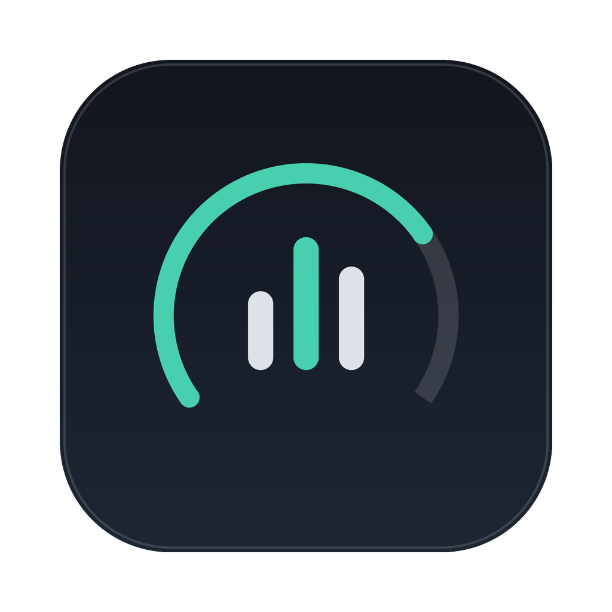

# 🌊 momi · AI 实时测速仪 (v1.6.1)

<p align="center">
  
</p>

<p align="center">
  <strong>专为 macOS 设计的轻量级 AI 实时输出速率 (Tokens Per Second) 测速仪</strong><br>
  常驻 Mac 顶部系统菜单栏 · 支持 Antigravity / Qoder / DeepSeek Harness / Pi / Claude Code / Codex / ZCode / Alma · 零依赖原生架构
</p>

---

## ✨ 核心特性

- ⚡ **实时 TPS 测速**：在 Mac 菜单栏常驻显示当前运行中的模型生成速率（如 `85.2 t/s`），尚无当轮测速结果时显示 `生成中`，全部空闲时显示 `--`。
- 📱 **多工具/多实例联合监听**：自动同时监听 **Antigravity Desktop / CLI**、**Qoder**、**DeepSeek Harness**、**Pi**、**Claude Code**、**Codex App**、**Codex CLI**、**ZCode** 与 **Alma**，按活动状态与实时速度自动排序并隐藏空会话实例；点击菜单中的 Agent 行可在访达中快速定位对应会话日志。
- 📊 **真实数据口径**：直接读取底层服务端上报的 `output_tokens` 与纯推理/请求耗时（排除工具执行等待时间），**不使用字符数估算伪造速度**；仅按额度计费且不上报 token 的模型（如 Qoder 原生模型）运行中显示 `运行中` / 统计页标注「按额度」。
- 📜 **可视化用量统计面板**：支持全部 / 近 7 天 / 今日切换与模型 / Agent 分组；内置**按日堆叠柱状图**（悬停查看单日明细）、**Top 5 构成分布条**与**缓存命中率**统计，表格支持**点击列头排序**、紧凑单位展示（悬停看精确数值）、快捷调整刷新频率与全量重建索引；点击仪表盘底部「累计使用 Token」即可直达。
- ⚙️ **原生设置与快捷键**：菜单内置「刷新频率」（`1.5s / 3s / 5s / 10s`）与「开机自启」（`SMAppService`）开关，支持 `⌘T` 打开统计、`⌘R` 刷新、`⌘W` 关闭窗口、`⌘Q` 退出。
- 🧠 **模型自动识别**：自动清洗并展示各 Agent 当前活动模型（如 `Claude Sonnet 4.6`、`GPT-5.4-Codex`）。
- 🪶 **原生极简，零额外负担**：基于 Swift + AppKit 原生编写，编译为单一独立二进制，不占用 Dock 栏与 `Cmd + Tab` 切换栏。

---

## 🚀 快速开始

### 1. 运行应用
编译出的应用默认安装至 `/Applications/momi.app`：
- **启动**：`Command + 空格` 搜索 `momi` 回车，或运行 `./scripts/start.sh`。
- **开机自启**：在顶部菜单栏下拉菜单中直接勾选「开机自启」，或在 **系统设置 → 通用 → 登录项** 中授权。

### 2. 源码构建与测试
```bash
git clone https://github.com/sqoder/momi.git
cd momi
chmod +x scripts/*.sh
./scripts/test.sh
./scripts/build.sh
```
- `scripts/test.sh`：执行全量 Swift 类型检查与 `tests/` 单元测试。
- `scripts/build.sh`：调用 `swiftc -O -target <arch>-apple-macos13.0` 编译、打包并签名安装至 `/Applications/momi.app`（支持环境变量 `MOMI_SIGN_IDENTITY="Developer ID Application: ..."` 进行公证签名）。

---

## 📁 目录结构

```text
momi/
├── src/
│   ├── Info.plist                 # macOS Menu Bar Accessory App 声明
│   ├── App/
│   │   ├── main.swift             # 程序入口
│   │   └── AppDelegate.swift      # 菜单栏、快捷键、定时调度与开机自启
│   ├── Core/
│   │   ├── ModelFormatting.swift  # 模型名清洗、速率限幅与 Agent 元数据
│   │   ├── MonitoredInstance.swift# 被监控实例状态模型
│   │   └── UsageModels.swift      # 统计模型、检查点与持久化结构
│   ├── Readers/
│   │   ├── LiveMonitor.swift      # 实时日志发现与各 Agent 测速解析
│   │   ├── UsageIndex.swift       # 全历史增量索引与 JSON 存储
│   │   ├── AlmaReader.swift       # Alma SQLite 只读数据源
│   │   └── ZCodeParser.swift      # ZCode rollout 共享解析器
│   └── UI/
│       ├── MomiDashboardView.swift# 菜单栏实时面板与可交互行
│       └── UsageStatsWindow.swift # 可视化用量统计面板（趋势图、分布条、列排序、索引重建）
├── resources/
│   ├── AppIcon.icns               # 原生高清 macOS 应用图标
│   ├── icon.png                   # README 展示图标
│   └── agents/                    # 各 Agent 单色模板图标
├── scripts/
│   ├── build.sh                   # 编译、签名并安装到 /Applications/momi.app
│   ├── test.sh                    # 运行类型检查与全部单元测试
│   ├── start.sh                   # 重启并启动应用
│   └── stop.sh                    # 安全退出应用
├── tests/                         # 核心格式化、ZCode 与 Alma 单元测试及夹具
├── plugins/
│   └── swiftbar/
│       └── momi_tps.2s.py         # 备用 SwiftBar 脚本（仅支持 Antigravity）
└── docs/
    └── plans/                     # 历史实现计划归档
```

---

## 🛠 技术原理

1. **会话日志抓取**：定时监听各 Agent 活动日志与投影缓存（如 `~/.gemini/antigravity/brain/*/.system_generated/logs/transcript.jsonl`、`~/.dsh/storages/session_projcache/sessions/*.json`、`~/.zcode/cli/rollout/model-io-*.jsonl`）；Alma 改为只读查询 `~/Library/Application Support/alma/chat_threads.db` SQLite (WAL)。
2. **端到端 TPS 测算**：
   $$\text{TPS} = \frac{\text{真实 Output Tokens}}{\text{真实生成时间差 (秒)}}$$
3. **Menu Bar 渲染**：利用 `NSStatusBar.system.statusItem` 构建原生菜单项与自绘统计窗口，配合低功耗异步增量扫描刷新。

---

## 🔒 隐私与分发说明

- **100% 本地只读，零网络请求**：momi 仅在本地只读解析各 AI 工具的本地会话记录与 SQLite 数据库，不采集、不上传任何对话内容、提示词或遥测数据。
- **分发方式（不上架 Mac App Store）**：由于 momi 需读取 `~/.claude`、`~/.codex`、`~/.gemini` 及 `~/Library/Application Support/alma` 等第三方工具本地目录，与 Mac App Store 沙盒规范不兼容，本项目仅面向源码构建与独立分发（Developer ID 签名 + Apple 公证 DMG）。

---

## 📄 开源协议与商标声明

- **开源协议**：MIT License — 详见 [LICENSE](LICENSE)。
- **第三方商标免责声明**：文中及界面提及的 Claude、Codex、Antigravity、DeepSeek、Qoder、Alma、ZCode、Pi 等产品与品牌名称均归各自权利人所有。momi 为独立开源工具，与上述任何品牌或厂商均无从属、赞助或官方关联关系。界面中所有图标均由本项目原创几何模板绘制，未包含任何第三方版权图形资源。
